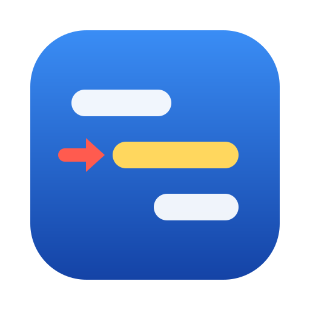
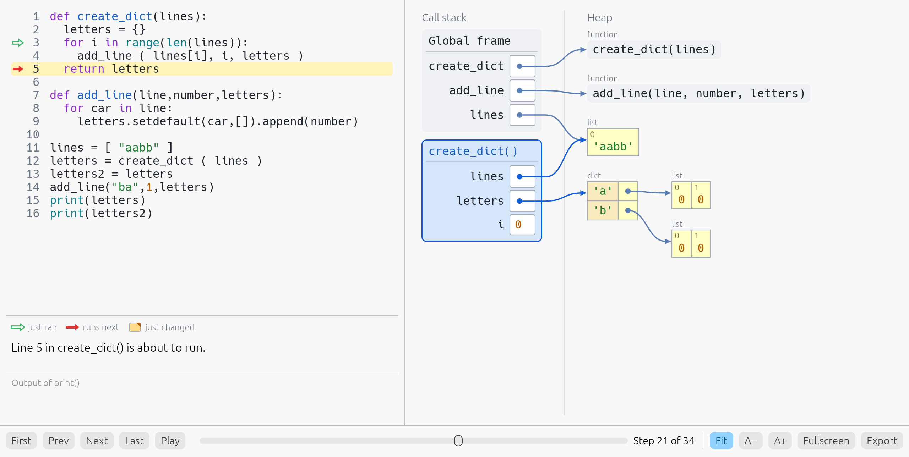
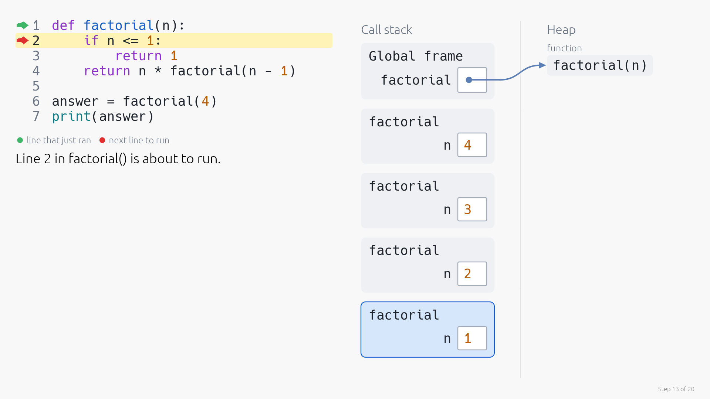
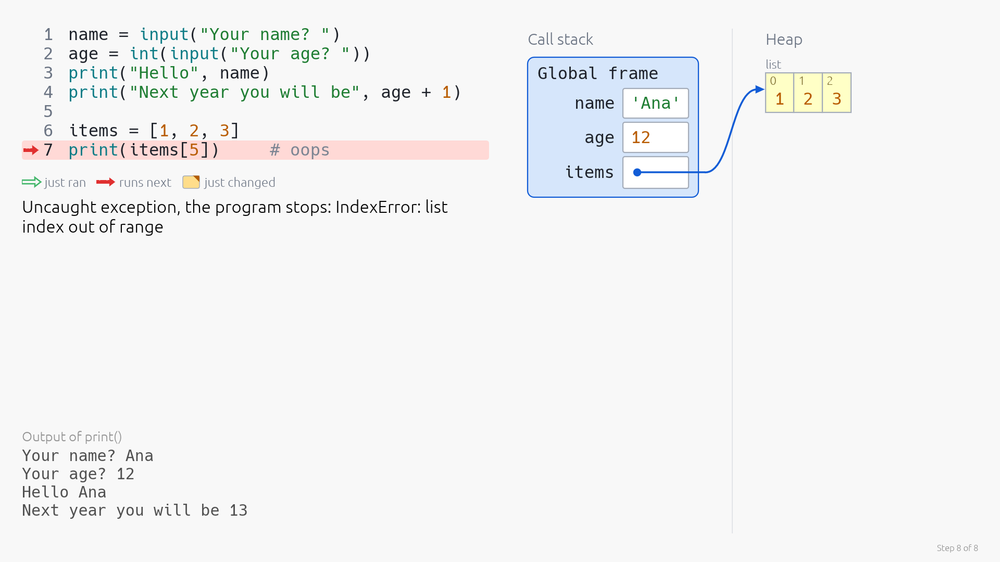
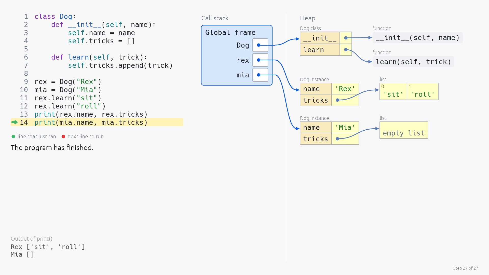
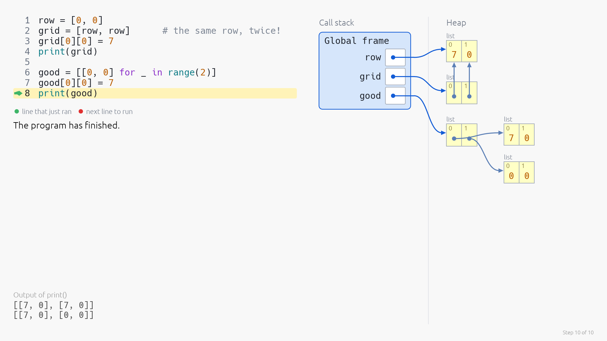
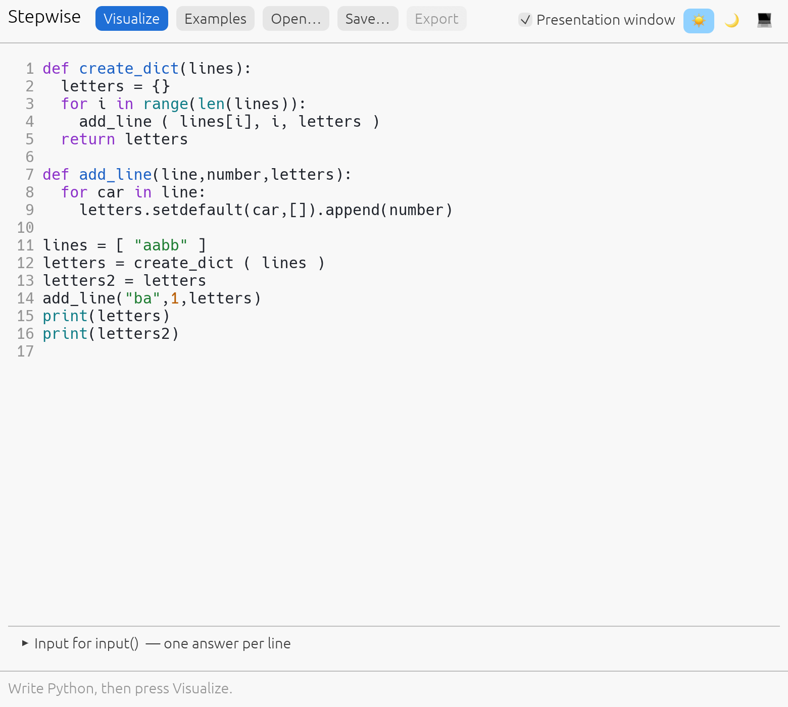
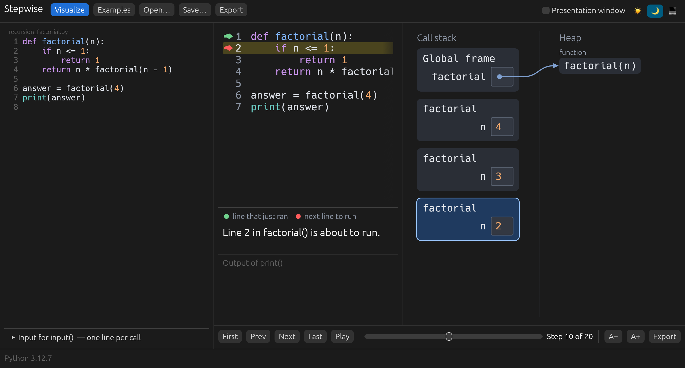
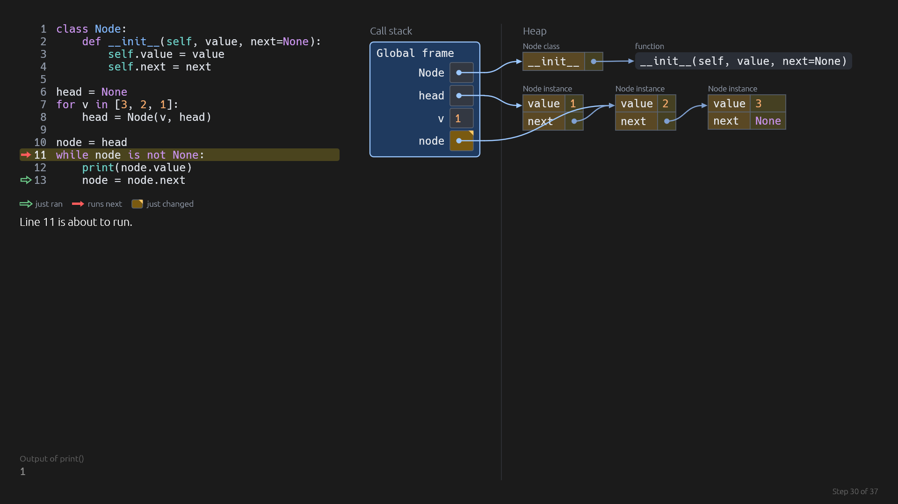

<p align="center">
  
</p>

<h1 align="center">Stepwise</h1>

<p align="center">
  <b>See Python code run, one step at a time.</b><br>
  Type a program, press Visualize, and step through it like a slide deck: the code, the call stack, the heap and the output.<br>
  A native desktop app for students and teachers, written in Rust with egui. Python is built in: nothing else to install.
</p>

<p align="center">
  
  
  
  
  
</p>

<br>

<p align="center">
  
  <br>
  <sub>The presentation window at step 21 of 34: <code>create_dict</code> is about to return the dictionary it built.</sub>
</p>

<p align="center">
  <a href="#highlights">Highlights</a> ·
  <a href="#watch-a-program-run">Watch it run</a> ·
  <a href="#call-stack-and-heap">Call stack and heap</a> ·
  <a href="#teach-from-a-second-window">Teach</a> ·
  <a href="#export-steps-as-png-pdf-or-powerpoint">Export</a> ·
  <a href="#from-the-command-line">Command line</a> ·
  <a href="#how-its-built">How it's built</a> ·
  <a href="#get-started">Get started</a> ·
  <a href="#limits">Limits</a> ·
  <a href="#credits">Credits</a>
</p>

---

## Highlights

<table>
<tr>
<td width="33%" valign="top">

### For students
Write a program and see what each line does: which variables exist, what they refer to, which function is running and what has been printed so far.

</td>
<td width="33%" valign="top">

### For teachers
The visualization opens in its own window. Put it on the projector and step with the arrow keys, while the editor stays on your laptop.

</td>
<td width="33%" valign="top">

### For handouts
Export one step as a PNG, or every step as a PDF, a PowerPoint file or a folder of PNGs. Exports never contain the buttons.

</td>
</tr>
</table>

---

## Watch a program run

Each step shows the program with two arrows: an outlined green one on the line that just ran, a solid red one on the line that runs next. A sentence under the code says what the step shows, in Python's own words.

<p align="center">
  
  <br>
  <sub>Recursion: one frame per call, the newest at the bottom, like a Python traceback.</sub>
</p>

- **Step like slides.** <kbd>→</kbd> and <kbd>←</kbd> move one step, <kbd>Home</kbd> and <kbd>End</kbd> jump to the ends, <kbd>Space</kbd> plays, and the slider scrubs.
- **What changed is marked.** A value that was just assigned gets a filled cell with a corner mark, inside lists and dictionaries too, and the running frame has a blue outline. The marks differ by shape as well as colour, so they survive a grey printout.
- **`input()` works.** When the program reaches `input()`, Stepwise asks for the answer and carries on. Answers are kept in the Input box, so the next run does not ask again.
- **Errors are shown where they happen.** A syntax error is marked on its line in the editor. An exception is shown on the line that raised it, including the uncaught one that stops the program.

<table>
<tr>
<td width="50%"></td>
<td width="50%"></td>
</tr>
<tr>
<td align="center"><sub>An uncaught <code>IndexError</code>, with the output printed before it</sub></td>
<td align="center"><sub>A class, its methods and two instances</sub></td>
</tr>
</table>

## Call stack and heap

The right side uses the two words students learn in class.

- **Call stack:** one frame per function call, holding that call's local variables. The Global frame holds the module's variables.
- **Heap:** lists, dictionaries, tuples, sets, class instances, classes and functions. A variable holds a reference to its object, drawn as an arrow.

Two variables that refer to the same object point at the same box, which is the fastest way to explain aliasing.

<p align="center">
  
  <br>
  <sub><code>grid = [row, row]</code> holds the same list twice; <code>good</code> holds two different lists.</sub>
</p>

Numbers, strings, `True`, `False` and `None` are written inside the variable's cell to keep the picture readable. In Python they are objects too.

## Teach from a second window

The editor is the teacher's console. The presentation is a separate window: drag it to the projector and press <kbd>F</kbd> for full screen.

<table>
<tr>
<td width="42%"></td>
<td width="58%"></td>
</tr>
<tr>
<td align="center"><sub>The editor: syntax colours, line numbers, examples</sub></td>
<td align="center"><sub>One-window mode, in the dark theme</sub></td>
</tr>
</table>

- **Edit without disturbing the slide.** The presentation keeps showing the last run until you press Visualize again (<kbd>⌘</kbd>/<kbd>Ctrl</kbd> + <kbd>Enter</kbd>).
- **Step from either window.** The editor has its own Prev and Next buttons.
- **Readable from the back row.** The picture sizes itself to the window. <kbd>+</kbd> and <kbd>−</kbd> set the text size by hand, and <kbd>0</kbd> goes back to fitting. Light and dark themes are both included.
- **One window if you prefer.** Untick *Presentation window* and the call stack and heap sit beside the editor, which then shows the step arrows, the sentence and the output itself.
- **Eleven examples** to start from: aliasing, loops, function calls, recursion, mutation, nested lists, dictionaries, classes, a linked list, input and an exception.

## Export steps as PNG, PDF or PowerPoint

The **Export** menu is in the editor toolbar and in the presentation bar.

| Choice | Result |
|---|---|
| This step as PNG | One 1920 × 1080 picture of the current step |
| All steps as PDF | One page per step |
| All steps as PowerPoint | One slide per step, 16:9 |
| All steps as PNG files | `step-001.png`, `step-002.png`, … in a folder |

Exports are drawn off-screen, so they do not depend on the window size and never contain the controls. All steps of a run share one scale, so the pictures line up when you flip through them. The current theme is used.

<p align="center">
  
  <br>
  <sub>A dark-theme export of a linked list being walked.</sub>
</p>

## From the command line

The same exports work without opening a window.

```sh
stepwise program.py                          # open the file in the editor
stepwise program.py --export deck.pdf        # every step, one page each
stepwise program.py --export deck.pptx       # every step, one slide each
stepwise program.py --export step.png --step 12
stepwise program.py --export frames/         # step-001.png, step-002.png, …
```

`--dark` uses the dark theme, and `--input 'Ana\n12'` supplies the text for `input()`. Without `--step`, a PNG shows the last step.

## How it's built

| File | Role |
|---|---|
| `src/main.rs` | The two windows, the editor, the step controls |
| `src/viz.rs` | Drawing of the code, the call stack and the heap |
| `src/trace.rs`, `src/tracer.py` | Running the program and recording every step |
| `src/export.rs` | Off-screen rendering, PNG, PDF and PowerPoint writers |
| `src/highlight.rs` | Python syntax colours |
| `src/examples.rs` | The built-in examples |

Python is [RustPython](https://github.com/RustPython/RustPython), an interpreter written in Rust and compiled into the app together with the standard library. To run a program, Stepwise starts a second copy of itself as the interpreter, so a program that loops forever can be stopped without touching the windows.

The program runs under `sys.settrace`. At every line, call, return and exception, a short tracer script records the call stack, the variables and the objects they reach. The app then only has to draw a list of snapshots, which is why stepping backwards is instant.

## Get started

You need [Rust](https://rustup.rs). Python does not have to be installed.

```sh
git clone https://github.com/bidouilles/stepwise
cd stepwise
cargo run --release
```

The first build takes a few minutes because it compiles the Python interpreter.

To trace with another Python instead of the built-in one, for example to use packages installed with pip, set `STEPWISE_PYTHON` to its path:

```sh
STEPWISE_PYTHON=/usr/bin/python3 stepwise program.py
```

## Limits

Stepwise is for the programs of an introductory course: short, self-contained, and small enough to fit on a slide.

- The built-in Python is RustPython, which follows the Python 3.14 language and includes the standard library (`math`, `random`, `collections`, …). It is not CPython: packages such as NumPy are not available, and a few error messages are worded differently.
- A run stops after 1000 steps or 8 seconds, and its last step says so. This catches infinite loops.
- A step is a line. You cannot step inside a line to see how its sub-expressions are evaluated; split the line and use temporary variables.
- Only the main thread is traced. Threads and `async` code run, but their steps are not shown.
- Code inside imported modules, and code run through `exec` or `eval`, is not shown.
- Closures work, but the frame an inner function was defined in is not drawn.
- Lists and dictionaries show their first 60 entries. Objects from libraries are shown as text, not as diagrams.
- `id()` and `is` on numbers and strings depend on the interpreter. Do not teach from them.

Reading and writing files, `sys.stderr` and `input()` all work, because the program runs on your own computer. `sys.argv` is always `['main.py']`.

### Long programs and crowded pictures

A few comments in the program keep a visualization small:

```python
# stepwise: hide i

total = 0
for i in range(10000):
    total += i
    if i % 1000 == 0:
        print(total)  # step
```

- **`# step`** at the end of a line: only the marked lines become steps. The loop above is shown in 11 steps (the ten marked lines and the end) instead of hitting the 1000-step limit.
- **`# stepwise: show total, letters`** draws only these variables.
- **`# stepwise: hide i, tmp_*`** leaves these variables out. `*` is a wildcard.
- **`# stepwise: hide types function, module`** leaves out every variable whose value has one of these types.

## Credits

Stepwise is inspired by [Python Tutor](https://pythontutor.com/visualize.html#mode=display), created by Philip Guo, which showed how much a picture of the call stack and the heap helps people who are learning to program.

Stepwise is a separate project, rebuilt from scratch in Rust. It shares no code, text or images with Python Tutor, and takes the idea in its own direction: a desktop app that works offline, a presentation window for teaching, and export to PNG, PDF and PowerPoint.

Stepwise is built on:

- [RustPython](https://github.com/RustPython/RustPython), the Python interpreter written in Rust that runs the programs.
- [egui and eframe](https://github.com/emilk/egui), for the windows and all the drawing.

## License

[MIT](LICENSE)
